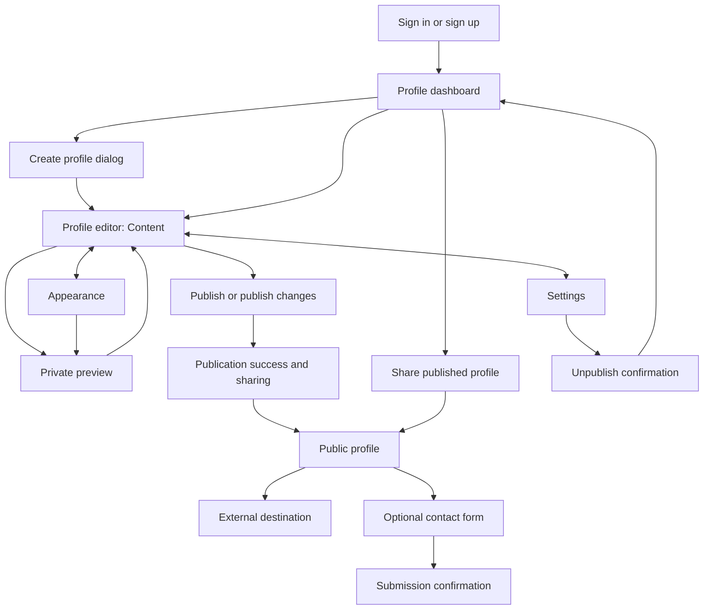

# Linky: MVP screen map and requirements

Status: functional product specification, October 23, 2026. Linky is a working name. This document specifies behavior; it is not a visual mockup or a claim of tested accessibility.

## 1. Product decisions and boundaries

Help creators, businesses, and agencies publish attractive link pages and receive inquiries. One signed-in account owner manages multiple independent profiles. The first release has no team memberships, client logins, or approval workflows.

This specification covers the profile dashboard, editor, and public profile. Authentication, subscriptions, analytics detail, and the inquiry inbox are adjacent dependencies, not fully specified screens. Do not ship navigation to those destinations until they work.

Defaults proposed for implementation:

- Free allows two published profiles; Pro allows ten. These are configurable commercial assumptions, not validated pricing decisions. Drafts do not consume published slots; a separate configurable abuse limit may restrict total drafts.
- Core content consists of links, social icons, text, and images. Pro adds one contact form per profile. Booking, messaging, and payment actions use external links.
- Custom domains, commerce, AI generation, social-feed synchronization, client collaboration, and profile duplication are deferred.
- Each profile has a stable internal ID, an owner-only label, a public display name, and a unique public handle. Account email and internal labels are never public.
- Before first publication, the handle can change. After first publication it is fixed for MVP to avoid silently breaking shared links. Handle migration is a later feature.
- Draft edits save privately. Publication is explicit and replaces the public snapshot only when the entire operation succeeds.

## 2. Screen map

Route names express intended navigation and are framework independent.

| Screen or surface | Intended route | Audience | Primary action |
| --- | --- | --- | --- |
| Profile dashboard | `/app/profiles` | Owner | Open or create a profile |
| Create profile | Dashboard dialog; full-screen on small devices | Owner | Create a private draft |
| Editor | `/app/profiles/:profileId/edit` | Owner | Edit content and publish |
| Editor sections | Content, Appearance, Settings within editor | Owner | Modify the selected profile |
| Private preview | In-editor preview surface | Owner only | Inspect the current draft |
| Share | Dialog from dashboard or publication success | Owner | Copy public URL or download QR |
| Public profile | `/@:handle` | Anyone | Follow a link or send an inquiry |
| Unavailable profile | Same public URL | Anyone | Understand that the page is unavailable |

Owner flow: sign in → choose or create a profile → edit → preview → publish → copy link → return to dashboard or switch profiles.

Visitor flow: open public link → identify the profile → scan content → choose a destination or submit the contact form.

## 3. Dashboard requirements

### Information and hierarchy

- Shared owner navigation identifies the account; the main area is titled “Profiles.” Show published-slot usage beside “Create profile.” A count at the limit must not imply that creating a private draft is forbidden.
- Show each profile's avatar fallback, owner label, public display name, handle, publication status, and last-edited time. Default ordering is most recently edited first, with stable ordering for ties.
- Show “Draft,” “Published,” “Published · unpublished changes,” or “Unpublished.” Saving and save failures are separate editor states, not publication states.
- Each item has a primary “Edit” action. “View live” and “Share” are available only when a public snapshot is active. Share always uses the live URL, never a preview URL.
- Support search by owner label, public name, or handle, plus All / Published / Not published filters. Preserve search and filter when returning from the editor.
- Keep analytics detail and inbox entry points profile-scoped when those adjacent features are available. Do not mix totals from different profiles or fabricate dashboard statistics before analytics exists.

### Create and switch

- Creation asks for owner label, display name, and handle. The owner label may initially match the display name and can be edited later.
- Validate handles as 3–30 lowercase letters, digits, or hyphens, starting and ending with a letter or digit. Normalize case, reserve platform/admin names, and show an explicit availability result.
- Handle availability checks are advisory until creation succeeds. If another account claims the handle first, retain the form and request a new handle.
- Successful creation opens that profile's editor as a private draft. Cancelling does not create a profile. Prevent repeated submissions while creation is pending.
- An editor profile switcher uses owner label plus handle to distinguish similarly named clients. Switching must respect pending-save protections described below.

### States and acceptance

- Empty account: explain that profiles are separate pages and offer “Create your first profile.” No sample profiles masquerading as real data.
- No search results: show a clear-filter action. Loading: reserve the list area. Failure: show a retry action without pretending there are zero profiles.
- At the published limit, allow editing and draft creation; explain the limit at publication and offer managing existing publications or opening working billing controls.
- Acceptance: create two profiles, find each by handle, edit one, and confirm the other's content, status, and public URL remain unchanged. Account A cannot enumerate or open account B's editor by substituting IDs.

## 4. Editor requirements

### Shared layout and context

- Persistent header: back to Profiles, selected profile label and handle, save state, Preview, and Publish / Publish changes. Published profiles also have “View live.”
- Keep profile identity visible in preview, publication feedback, and sharing. Browser Back and direct editor links restore the correct profile; late saves or upload responses from another profile cannot update the active editor.
- Content, Appearance, and Settings share the same profile context and draft. Switching sections must not reset edits.
- Desktop pairs editing controls with a phone-width preview. On small screens, Edit and Preview are separate full-width views with an obvious return action. Keep publishing controls reachable without covering inputs or validation messages.
- The preview and public page use the same content-rendering rules. Preview is clearly labeled “Draft preview”; external navigation and contact submission are disabled in preview, with explanatory feedback. Preview activity is excluded from analytics.

### Content

| Element | Editable properties | Required behavior |
| --- | --- | --- |
| Identity | Avatar, public display name, bio | Public name is required; avatar and bio are optional |
| Link block | Label and destination URL | Both required; reject unsafe URL schemes |
| Social links | Supported platform and profile URL | Accessible names include the platform; generic websites use a link block |
| Text block | Plain text | Preserve line breaks; no raw HTML or scripts |
| Image block | Uploaded image, alt text or decorative designation, optional destination | Show upload progress and a recoverable error; no publishing an unfinished upload |
| Contact block | Heading and submit-button label | Pro only, maximum one per profile; fixed visitor fields described below |

- Add, edit, hide/show, reorder, and remove blocks. Hidden blocks remain editable but are absent from the published output.
- Drag-to-reorder is supplemented by keyboard-accessible “Move up” and “Move down” controls. Announce the new position and keep focus on the moved block.
- Removing a block offers session-local Undo until another removal or navigation. Use a confirmation before removal if Undo is unavailable.
- Uploads accept JPEG, PNG, and WebP up to 5 MB each. Explain the restrictions before file selection; validate file content as well as extension. Keep the previous image if a replacement fails.
- Suggested content limits: display name 80 characters, bio 300, link label 120, text block 2,000, image alt text 300. Show limits beside constrained fields; do not silently truncate saved content.
- Link and optional image destinations accept HTTP/HTTPS only. Messaging, booking, and payment links use their HTTPS destinations. Arbitrary embeds and executable content are out of scope.

### Appearance

- Choose from a small template set, then adjust background, text and accent colors, font from a curated set, and button shape. Templates change styling without deleting or rearranging content.
- Keep a clear heading hierarchy and predictable spacing across templates. Long names, URLs, and translated browser text must wrap without horizontal scrolling.
- Templates must meet contrast targets by default. Custom text/background combinations that fail required contrast must be explained and blocked from publication until corrected. Preview remains available to correct them.
- Branding removal and advanced styling may be paid entitlements; identify gated controls before selection. Do not silently apply paid styling to a published free profile.
- Final palette, typography, templates, and brand identity require a separate visual design pass; this document does not prescribe a finished aesthetic.

### Settings and publication lifecycle

- Settings contains the owner label, public URL, publication state, and unpublish action. Display the fixed-handle restriction after first publication.
- Autosave changed drafts after a short idle period and show “Saving…,” “All changes saved,” or “Could not save” with Retry. A save acknowledgment is the only basis for claiming changes are saved.
- On leaving, closing the preview, or switching profiles, only navigation that would lose unsaved data needs protection. Wait for pending saves; on failure, offer Stay and retry or Discard unsaved changes. Browser close uses the available native unsaved-change warning.
- If a newer draft was saved in another tab, avoid silently overwriting it. Explain the conflict and let the owner reload the latest saved version after warning that local unsaved changes will be discarded.
- First publication requires an available handle, public name, at least one valid visible block or social link, complete uploads, valid appearance, and an available plan slot. Hidden incomplete blocks do not block publication.
- Publish is unavailable while saving, uploading, or submitting publication. If validation fails, explain why and focus the first relevant field. If publication fails, retain the previous live version and draft; offer Retry.
- Publication success shows the public URL, “Copy link,” “View live,” and “Download QR.” Do not announce success before the public snapshot is active. Further edits return the status to “Published · unpublished changes.”
- Publishing an unchanged draft is disabled with a clear “No unpublished changes” state. A later edit must never be accidentally included in an already-submitted publication operation.
- Unpublish requires confirmation explaining that visitors will see an unavailable page. Retain the draft and handle; free the published slot after success. Republishing uses the same URL and rechecks current limits and validation.
- Profile deletion is deferred; account deletion remains an account-settings dependency. Do not add a nonfunctional delete button to these screens.

### Acceptance

- Edit a published profile's title and reorder its links: preview changes immediately; visitors retain the previous version until publication succeeds.
- Refresh after a confirmed save: the draft returns intact. Simulate save or publication failure: edits remain recoverable and the last published version remains available.
- Use only a keyboard to add, reorder, edit, hide, and publish a block. Repeat core editing and publication on a narrow mobile viewport.
- Open two tabs on one profile and verify stale saves cannot silently overwrite newer work. Switch between two profiles and verify no preview, upload, or saved content crosses profile boundaries.

## 5. Public profile requirements

### Structure and behavior

- Render only the active published snapshot: identity header, social links, visible blocks in saved order, optional contact form, and platform branding when required. No owner controls or draft content.
- Visitors need no account. Keep the page mobile-first with a readable centered content column on wider screens. Images preserve aspect ratio, reserve space while loading, and cannot obscure link labels.
- Open destinations in the same tab by default so browser Back returns to the profile. Accessible names must describe the destination; image-only links need equivalent text.
- Generate page title and sharing description from the published name and bio. Use the published avatar where a sharing image is supported; never leak draft metadata.
- Track page views and link clicks against the published profile and block. Tracking failure must not delay or prevent navigation. Counting, retention, and privacy disclosures belong to the analytics specification.
- Show a working abuse-report action that opens a minimal form for category and explanation. Confirm receipt without exposing the owner's email. Moderation handling is a launch dependency.

### Contact form

- Show only when a published contact block is enabled and the account has the required entitlement. Fields: optional name, required email, and required message. Limits: name 100 characters, email 254, message 5,000.
- Display a concise disclosure that the submission is shared with this profile's owner for responding to the inquiry, with a working privacy-policy link. No automatic marketing subscription.
- Validate inline, retain entered text on failure, prevent repeated submission while pending, and show a clear success receipt only after durable acceptance. Retries of an uncertain submission must not create duplicate inquiries.
- Associate the inquiry with this profile's owner and profile, independently of any visitor-supplied identifiers. Deliver it to the working profile-scoped inbox; email notifications are not required by this specification.
- In the editor, explain that inquiries arrive in this profile's inbox before enabling the form. Submission acceptance means the inquiry was saved, not that the owner read it or an email was delivered.
- Recheck publication and form availability when accepting a submission. If the page was unpublished or form access changed while the visitor was composing, explain that submission is unavailable and preserve the message for copying.
- Apply server-side spam/rate controls. An unavailable or rate-limited form explains the failure without clearing the visitor's message. Public preview never accepts real inquiries.

### Unavailable and error states

- Unknown, draft-only, unpublished, and suspended handles show a neutral “This page is unavailable” state without revealing private identity, suspension reasons, or draft content. Do not return a branded success page for a missing profile.
- A temporary loading/service failure shows “We couldn't load this page” and Retry, distinct from a genuinely unavailable profile.
- An individual failed image retains its alternative text and layout; other links continue to work. An analytics or inquiry service failure must not take down the rest of the page.
- Publication and unpublication must invalidate cached content and metadata so obsolete content is not deliberately served after the operation reports success.

### Acceptance

- A signed-out visitor can open each published profile, follow destinations, return with Back, and submit a valid inquiry when enabled.
- Unpublished content is unavailable through the public URL, page metadata, preview endpoints, and public content responses. Private editor preview requires owner authentication.
- Hide or remove a block and publish: visitors and share metadata contain only the new snapshot. Unpublish: the previous snapshot is no longer served by the application.
- A failed form submission preserves values; a successful retry produces one inquiry under the correct profile. Public responses never expose account email or inquiries.

## 6. Shared accessibility and state requirements

- Target WCAG 2.2 AA: semantic headings and landmarks, programmatic field labels, meaningful error associations, visible keyboard focus, and sufficient text/control contrast. These are acceptance targets, not a certification claim.
- Dialogs move focus inside, support Escape where safe, keep focus contained, and return it to the trigger. Destructive confirmation puts initial focus on the safe action.
- Status changes are available to assistive technology and are never communicated by color alone. Avoid announcing every keystroke or preview update.
- Use touch targets of at least 44 × 44 CSS pixels where practical. Verify at 320, 390, 768, and 1440 CSS-pixel widths, at 200% zoom, and with reduced motion enabled.
- Every asynchronous action has an identifiable pending state, success outcome, recoverable failure, and protection against duplicate submission. Disabled controls explain the reason nearby.
- Preserve inputs after recoverable errors. If authentication expires during editing, request sign-in without claiming that unsaved edits were saved or discarding recoverable local edits.

## 7. Delivery sequence, dependencies, and open decisions

1. Visual Design: turn these flows into dashboard, editor, and public-page wireframes, including mobile and failure states. Establish a distinct visual direction before polished mockups.
2. Product/Engineering planning: select authentication, data/storage, hosting, and billing services; check their current documentation; define ownership checks, snapshot publishing, cache invalidation, and inquiry delivery.
3. Sol Coder: implement the shared owner shell, dashboard, content editor, draft saves, preview, and public publishing as the first end-to-end slice. Build shared rendering and composition rather than duplicating templates.
4. Sol Coder: add appearance controls, sharing/QR, plan entitlements, and contact forms once their adjacent dependencies work. Enforce account ownership and limits on the server, not only in controls.
5. Design and Astra review: inspect rendered desktop/mobile states and verify the acceptance scenarios above. Test account isolation, save conflicts, failed publication, inaccessible drafts, and inquiry routing explicitly.

Open commercial decisions: confirm Free/Pro limits, subscription price, and downgrade grace rules. Until these are settled, treat limits as configurable and do not automatically unpublish customer pages or erase saved paid settings on downgrade. Checkout and automated downgrades are blocked on that policy; core wireframes and publishing implementation are not.

Other follow-up decisions: final product name, visual identity, reserved-handle list, and the precise analytics/privacy specification. No external API integration or technical stack is selected or verified by this document.

Verification record: requirements reviewed against the agreed multi-profile scope and lifecycle scenarios. No application exists yet; no runtime, usability, performance, or accessibility tests have been performed.
