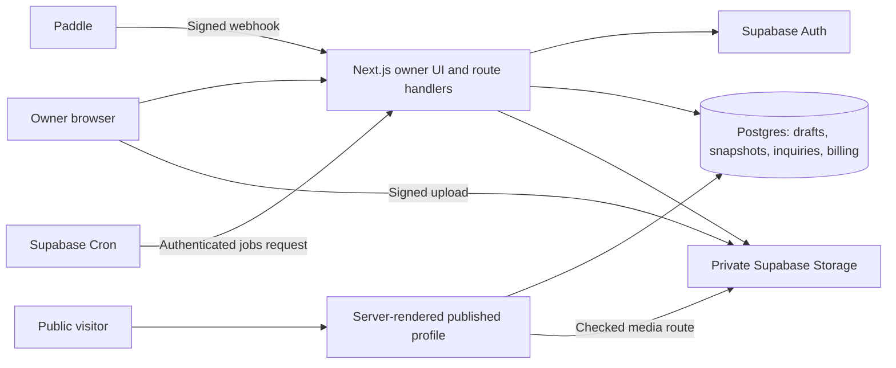

# Introduction

Build one Next.js and TypeScript application on Vercel, with Supabase Auth, Postgres, and private Storage. Preserve the approved Warm Editorial dashboard, editor, and public profile design. Deliver the first complete journey from sign-in through two independent profiles, private editing, and explicit publishing before adding subscriptions, inquiries, and analytics. This is a planning deliverable; no application, cloud resources, or payment accounts have been created by this plan.

The user confirmed the stack and a Philippines-registered business. Billing assumes Paddle for sandbox implementation, conditional on merchant and payout approval; Lemon Squeezy is the fallback candidate with explicit Philippines bank-payout coverage. Live checkout remains disabled until business approval and commercial policy are settled.

## 1. Requirements & Constraints

- **REQ-001:** One owner account manages multiple profiles. Use configurable defaults of two published profiles on Free and ten on Pro. No client seats, teams, or role hierarchy in MVP.
- **REQ-002:** Preserve the approved dashboard, Content/Appearance/Settings editor, shared preview/public rendering, responsive behavior, save feedback, and failure states. Add real auth, uploads, publication, sharing/QR, billing, profile analytics, and inquiry inbox.
- **REQ-003:** Draft changes never alter the public snapshot until an explicit successful publish. Unpublish retains draft and handle while making public content unavailable.
- **REQ-004:** Support links, plain text, images, social links, and at most one Pro contact form. Retain keyboard reorder, hide/show, removal Undo, and owner-only labels.
- **REQ-005:** Public output and metadata contain only published fields. Unknown, unpublished, and suspended handles return neutral 404 responses; backend outages return a distinct retryable error.
- **SEC-001:** Enforce ownership, account status, plan limits, and payload validation on the server and at database mutation boundaries. UI gating is explanatory, not authorization.
- **SEC-002:** Private drafts, inquiries, billing events, upload originals, and owner metadata are never anonymously selectable. Never expose a Supabase secret key in browser code.
- **CON-001:** Existing files under `docs/` are reference artifacts. The prototype is a dependency-free DOM/localStorage demonstration, not a production foundation or customer dataset. Do not import its fictional profiles into production.
- **CON-002:** The workspace currently has no package manifest, application scaffold, or Git repository. Initialize application tooling and version control during implementation; preserve all existing documents.
- **CON-003:** Exclude custom domains, commerce, AI, embeds, social feeds, collaboration, profile duplication, and individual profile deletion. Account deletion is included.
- **PAT-001:** Use framework layouts, feature modules, and a single profile renderer. Keep shared utilities limited to authentication, database clients, validation primitives, logging, and UI controls. Avoid a separate API service, generic repository framework, and a second client state store until justified.

### Architecture decisions

| Area | Selected approach | Reason and boundary |
| --- | --- | --- |
| Application | Next.js App Router, TypeScript, React, Node runtime | Server-rendered public content and owner pages in one deployable app; client components for editor interaction |
| Versions | Next.js 16 baseline; pin exact stable packages and compatible Node LTS at bootstrap | Official installation page currently identifies v16.4.2; no installed versions exist yet. Recheck security advisories and deployment compatibility before locking versions |
| Styling | CSS Modules plus shared CSS custom properties | Port approved tokens and responsive layouts without introducing a different component-library aesthetic |
| Authentication | Supabase email OTP with cookie-based SSR | Verified email, sign-in/sign-up and resend states; custom production SMTP is required |
| Persistence | Supabase Postgres, versioned SQL migrations and generated TS database types | Transactions enforce publication, limits, and idempotency without a second ORM layer |
| Assets | Private Supabase buckets; direct signed uploads; validated derivatives | Keep draft assets private and bypass Vercel request-size limits |
| Public rendering | Fresh request-time reads, no shared page/media cache for MVP | Reliable unpublish and suspension behavior before optimizing caching |
| Billing | Paddle sandbox and hosted customer portal | Documented subscription lifecycle and webhook testing; live merchant approval is a separate gate |
| Background work | Postgres job ledger plus Supabase Cron calling a protected Next route | Durable webhook processing, reconciliation, deletion, and cleanup without adding a queue vendor |
| Tests | Type checks/lint, focused Vitest tests, Supabase database tests, Playwright journeys | Verify observable behavior and authorization boundaries |

Use `@supabase/ssr` and `@supabase/supabase-js`; validate identity with `getClaims`, and use a fresh `getUser`/reauthentication check for account deletion. Read current account status from the database, since a valid JWT does not prove the account is still active. Session refresh belongs in the documented Next Proxy flow. Responses containing sessions or private content must not enter shared caches. [Supabase SSR guidance](https://supabase.com/docs/guides/auth/server-side/creating-a-client)

Disable Cache Components initially and use the installed version's supported request-time rendering mechanism, including `connection()` where appropriate. Do not carry over removed caching options from an older Next version. Public page, metadata, and media access must all check current publication/account status. Set explicit no-store response behavior and verify it on Vercel, not only locally. Already downloaded content and third-party social previews cannot be recalled. [Next connection](https://nextjs.org/docs/app/api-reference/functions/connection), [route configuration](https://nextjs.org/docs/app/api-reference/file-conventions/route-segment-config)

### Data model and access boundaries

Use UUID primary keys and UTC timestamps. Keep domain tables in a non-exposed `private` schema. Expose only narrowly granted database functions through the Data API; no direct browser writes to domain tables. Use RLS on owner-scoped tables as defense in depth. Grant authenticated users only the owner operations they need; privileged public-read/ingest and job functions are callable only by the server role. Revoke default PUBLIC function execution. A security-definer function must use a fixed search path, explicit qualified names, an active-account check, and ownership derived from verified `auth.uid()`, never an arbitrary owner argument. Internal server-role operations require their own narrow checks because the server role bypasses RLS. [RLS](https://supabase.com/docs/guides/database/postgres/row-level-security), [function permissions](https://supabase.com/docs/guides/database/functions)

| Entity | Principal fields and constraints | Access / lifecycle |
| --- | --- | --- |
| `accounts` | Auth user ID, status active/deleting/suspended, created time | One account per auth user; status gates all owner and public operations |
| `profiles` | ID, owner ID, owner label, normalized unique handle, first-published time, current publication ID, timestamps | Owner only; indexed owner + updated time + ID; handle immutable after first publish |
| `profile_drafts` | Profile ID, revision integer, schema version, identity/theme/socials/ordered-blocks JSONB | One document per profile; stable UUID per block; bounded to 100 blocks and 256 KB |
| `profile_publications` | ID, profile ID, source revision, schema version, public payload, created time | Immutable snapshot; private historical data. Only the pointer on an active profile makes one readable publicly |
| `assets` | ID, owner/profile IDs, immutable object keys, state pending/ready/rejected, MIME, bytes, dimensions | Quarantine originals and safe derivatives; asset ownership cannot change |
| `publication_assets` | Publication ID + asset ID | Explicit references for public-media authorization and safe garbage collection |
| `inquiries` | ID, profile ID, owner ID, name/email/message, receipt key, created/read times | Owner inbox only; unique profile + idempotency key; derive owner from profile |
| `analytics_events` / `analytics_daily` | Event ID, profile/publication/block ID, type, server timestamp / day and counts | Server inserts only; owner reads profile aggregates; no emails or message content |
| `subscriptions` | Owner ID, provider/customer/subscription IDs, provider status, effective dates, last reconciliation | Unique provider subscription; one effective subscription per owner; clients cannot change entitlements |
| `billing_events` / `jobs` | Unique provider event ID, payload, receipt time, state, attempt count, lease/next-attempt/error | Internal only; retryable, deduplicated, auditable processing |
| `abuse_reports` / `moderation_actions` | Profile ID, category, bounded explanation, operator action/reason/time | Internal only; report endpoint never discloses owner contact details |
| `rate_buckets` / `operation_receipts` | Scoped key, window/count / operation ID and result | Atomic persistent limits and retry receipts; scheduled expiry |

The draft document keeps block order and edits atomic without a large table graph. Validate its versioned shape server-side; database functions also enforce structural bounds, ownership, revision, and publication rules so direct RPC requests cannot bypass them. Keep billing, inquiries, assets, and analytics relational because they have independent access and lifecycle rules. A new schema version must remain readable alongside the preceding version during deployment.

### Save, publish, and media contracts

1. **Save:** Debounce editor writes by 750 ms; serialize writes per profile. Send expected revision and a request ID. Accept only if revision matches, then return the new revision. Repeated request IDs return the original result. A conflict returns 409 and offers reload or copy unsaved work; never silently overwrite. Navigation flushes or explicitly protects pending edits. Session expiry retains in-memory input while reauthentication runs.
2. **Publish:** Flush the intended draft and submit its revision plus operation ID. In one transaction lock account first, then profile; verify ownership, active status, handle, entitlement, published-slot count, ready owned assets, and visible content. Reject a revision mismatch. Copy only allowed public fields into an immutable snapshot and switch its pointer atomically. A retry returns the same result. Later saves remain unpublished.
3. **Unpublish:** Use the same lock order and idempotency contract, remove the current pointer, retain handle and draft. No successful public request may deliberately select the previous snapshot after commit. Suspension and account deletion use the same availability rule. Serialize plan updates with publication using the account lock.
4. **Validation:** Handle length 3–30, lowercase alphanumeric/hyphen, alphanumeric ends; unique database constraint and reserved list. Initial reserved names: admin, api, app, auth, billing, help, login, logout, privacy, settings, signup, support, terms, www, linky. Owner label max80; public name80; bio300; link label120; text2000; alt300; URL2048; optional form name100, email254, message5000. URLs allow HTTP/HTTPS only, reject embedded credentials, and are never server-fetched for previews. Hidden incomplete blocks may be saved but are omitted from publication validation/output. Appearance uses allowlisted fonts/shapes and contrast checks.
5. **Upload:** Owner requests a signed unique quarantine path; browser uploads JPEG/PNG/WebP up to 5,000,000 bytes directly. Finalization checks actual bytes, decodes with a pixel limit of 20 megapixels, rejects malformed/animated images, strips metadata, and generates a derivative bounded to 1600px and 1 MB. Replacement succeeds only after validation, preserving the previous image on failure. Never overwrite a published asset key. The browser cannot set `ready` or write derivative objects.
6. **Serve:** An owner-only preview media route checks ownership. A public media route checks that the asset belongs to the currently active snapshot, then serves the derivative with no-store. Do not redirect to a long-lived signed URL or enable Next image/CDN caching for these routes. Derivatives stay below Vercel's response limit. Asset finalization reads the original server-to-server, with bounded decode memory and duration; do not send the 5 MB original through a function response.
7. **Cleanup:** Delete abandoned uploads older than 24 hours and unreferenced derivatives after seven days. Compute references from drafts and retained publications; retain superseded snapshots for seven days, then remove them. Account deletion overrides ordinary retention. Never delete an asset used by the active snapshot.

**Cleanup concurrency:** Add `deleting` to the asset states. Save, publish, finalization and cleanup all acquire locks in account → profile → asset-ID order when touching media references. Cleanup atomically rechecks references and claims an eligible asset as deleting before requesting Storage deletion. New references to a deleting asset are rejected; Storage deletion retries keep that claim until confirmed. This closes the gap between checking database references and deleting an external object.

Supabase provides signed upload URLs and private-bucket access control. Vercel documents a 4.5 MB function request/response payload ceiling; this drives the direct-upload and small-derivative design. [Signed upload API](https://supabase.com/docs/reference/javascript/storage-from-createsigneduploadurl), [private buckets](https://supabase.com/docs/guides/storage/buckets/fundamentals), [function limits](https://vercel.com/docs/functions/limitations)

### Routes and request behavior

| Route / operation | Contract |
| --- | --- |
| `/login`, `/auth/verify` | Email OTP, expiry/resend/error states, safe internal return URL, enumeration-resistant messages |
| `/app/profiles` | Owner list; search/filter in query string; stable pagination; create profile and plan usage |
| `/app/profiles/[id]/edit` | Content/Appearance/Settings; revisioned save; shared draft preview; publish/unpublish/share |
| `/app/profiles/[id]/inbox`, `/analytics` | Owner-only profile scope, pagination/date range, genuine zero-data states |
| `/app/billing`, `/app/settings` | Subscription/portal status; account details, sign-out and confirmed deletion |
| `/@handle` | Request-time HTML, canonical metadata, plain working outbound links, optional inquiry form |
| `/api/profiles` and `/api/profiles/[id]/*` | Create/list/save/publish/unpublish; cookie session, same-origin checks, JSON size bounds, idempotency |
| `/api/assets/*`, `/api/media/*` | Signed upload/finalize; private-preview and published-media checks |
| `/api/public/[handle]/inquiries`, `/events`, `/reports` | Narrow public ingest; derive profile/owner; validate live state and rate limits |
| `/api/billing/checkout`, `/portal`, `/webhook` | Owner checkout/portal; signature-verified provider webhook |
| `/api/internal/jobs` | Secret-authenticated bounded worker batches; unavailable to normal users |

In Next, implement the public route with `src/app/[publicHandle]/page.tsx` and require its segment to begin with `@`; do not mistake `@handle` for a parallel-route directory. Static owner/auth routes take precedence. Metadata and HTML use the same snapshot selected for that request. Return 400/422 for invalid input, 401 for expired auth, indistinguishable 404 for inaccessible owner resources, 409 for revision/handle/plan conflicts, 429 with retry guidance, and 503 for transient service failure. Provide stable error codes and field errors, never raw SQL or provider secrets.

### Billing, inquiries, analytics, and operations

**Billing policy for implementation:** One monthly Pro subscription per owner, no trial or annual billing initially. Price and currency remain commercial gates. Free/Pro publish limits are configuration, not hardcoded UI logic. Reserve only published slots; default total-profile abuse cap is 30 per account. Apply current server entitlements to publication and inquiry acceptance, not JWT claims or checkout-success query parameters.

Paddle is a candidate, not an approved merchant account. Supported customer countries do not prove seller eligibility. Lemon Squeezy explicitly lists Philippines bank payouts, also subject to store approval. Do not assume direct Stripe Payments onboarding for a Philippine entity: its global availability list and Philippine legal eligibility wording are not sufficient confirmation. [Paddle coverage](https://developer.paddle.com/concepts/sell/supported-countries-locales/), [Lemon Squeezy payouts](https://docs.lemonsqueezy.com/help/getting-started/supported-countries), [store approval](https://docs.lemonsqueezy.com/help/getting-started/activate-your-store), [Stripe availability](https://stripe.com/global)

Create checkout server-side from an allowlisted product/price and trusted account mapping. Persist checkout intent, prevent concurrent duplicate subscriptions, and reconcile ambiguous creation results before retrying. Portal sessions belong to the authenticated account. Checkout return displays pending until verified billing state arrives.

Verify Paddle signatures over unchanged raw bytes. Durably insert the unique event ID before returning 2xx within its five-second target; storage failure returns non-2xx for redelivery. Worker jobs use leases, retries with backoff, and per-subscription serialization. Since events can arrive twice or out of order, reconcile the canonical provider subscription before updating local access; retain event ordering metadata and never regress state from an older event. Process bounded batches every minute and reconcile active subscriptions daily. Alert on stuck/failed events. [Paddle webhook delivery](https://developer.paddle.com/webhooks/about/how-webhooks-work/), [signature verification](https://developer.paddle.com/webhooks/about/signature-verification/)

Pro remains active for active/trialing and automatically collected past-due subscriptions during provider retries; scheduled cancellation keeps access until effective. When cancellation/expiry takes effect, use this **proposed conservative downgrade policy**, pending product acceptance: preserve all public pages and paid appearance already published; disable new paid forms, stop new inquiry acceptance, retain inbox access, and block further publication while the owner exceeds Free limits. The owner selects pages to unpublish to regain publication rights. Draft editing remains available; never erase saved paid settings. On a later Free publication, require removal of the contact block and restoration of required branding. Display the restrictions explicitly. Live checkout and automated downgrades remain disabled until this policy is accepted. [Paddle subscription states](https://developer.paddle.com/build/subscriptions/provision-access-webhooks/)

**Inquiries:** Accept only against the current published form and current entitlement in the same transaction as insertion. Persist a receipt key and content hash; retries with identical content return the original receipt, while changed content with the same key returns conflict. Recheck publication/form state under the profile lock. Escape content in inbox; no automatic email forwarding or marketing subscriptions. Keep inputs after network, rate, or entitlement failures. Preview cannot submit.

Inquiry acceptance locks the account before the profile, matching publication and subscription updates. It reads entitlement and publication state only after obtaining those locks. Thus a committed downgrade cannot be followed by acceptance based on the old plan; a submission that acquires the locks first may complete before the downgrade.

**Analytics:** Count page-view events and link-click events, not unique people. Ordinary anchors work even if the event request fails; use nonblocking beacon delivery. Preview and owner editing never emit events. Issue a short-lived page-event token bound to publication; validate block membership and bound event sizes, while acknowledging that browser events can still be fabricated. Deduplicate event IDs; use server timestamps and UTC daily buckets. Keep raw events seven days and daily totals 90 days. No cookies, full referrer URLs, raw IPs, or cross-site identifiers in analytics. Explain imperfect counts and show last-update time. Aggregate through a transactional watermark so retries never double count.

**Abuse controls:** Use atomic database rate buckets, not per-process memory. Starting limits: inquiries 5 per 10 minutes per profile/IP-derived key and 20 per day globally per key; reports 5/hour per key; analytics 120/minute per key; uploads 20/hour per account. Hash network identifiers with a rotating server secret and expire buckets after at most 48 hours; confirm trusted proxy header handling on deployment. Add a hidden honeypot to public forms and combine network limits with per-profile quotas so one shared IP is not the only control. Auth retains Supabase limits. Limits are tuning defaults, not a claim to prevent all spam. Bound report explanation to 2,000 characters. A protected operator runbook must support report review, suspension, restoration, and logged decisions before public launch; no customer-facing admin role.

**Deletion:** Require recent authentication and explicit confirmation. First mark the account deleting and remove public availability transactionally, then run idempotent jobs to cancel billing, delete storage, purge customer content, and remove the Auth user. Failures retry and remain visible to operations; never claim completion early. Keep only billing records required by the adopted retention policy, with access restricted and customer content removed. Handle valid but stale JWTs by checking account status in every path. Document backup expiry and third-party retention separately.

Retain a minimal internal deletion tombstone, provider/customer mapping and outstanding checkout intents independently of the Auth row. Stop issuing checkout and upload capabilities as soon as deletion begins. Expire outstanding checkout transactions where supported; otherwise reconcile until they are closed. Late subscription creation for a deleting/deleted account enqueues immediate cancellation and never recreates the account or restores access. Tombstones remain while provider intents/subscriptions can still settle, under the adopted billing retention policy.

Record each signed upload capability's actual provider expiry and quarantine path. Deletion must wait for issued capabilities and in-flight uploads/finalizers to settle, then sweep those paths again before reporting storage cleanup complete. Finalization checks account status before and after transformation and cannot recreate deleted records; a completed external write after deletion begins is queued for cleanup. Retry the sweep after capability expiry and verify absence, rather than assuming JWT revocation invalidates a previously signed URL. Public access stays disabled throughout this cleanup interval.

**Operations:** Use separate local/staging/production Supabase projects and payment modes. Keep Vercel functions near the database; verify the chosen region before provisioning. Secrets stay in deployment configuration, not committed files. Cron calls the internal route with a rotated secret stored in Supabase Vault. Emit structured request IDs, operation type, duration, result/error code, and opaque resource IDs; exclude OTPs, cookies, keys, inquiry bodies, and full webhook payloads. Monitor public failures, save/publish errors, auth delivery, webhook backlog, and cleanup failures. Daily retention jobs must be bounded and retryable. [Supabase Cron](https://supabase.com/docs/guides/cron), [Vault](https://supabase.com/docs/guides/database/vault)

## 2. Implementation Steps

First milestone local implementation was reviewed on 2026-10-23; see [verification](../artifacts/verification.md) and [manager review](../docs/milestone-one-review/README.md). Later milestones remain unstarted. Staging SMTP and cloud delivery remain pending. Owner: Sol Coder for application/migration/test implementation; Astra owns sequencing and review; Astra Design reviews new adjacent screens and rendered integration. A phase starts only after listed dependencies pass. Shared migrations, dependencies, and route contracts have one writer at a time. Independent visual review and provider onboarding can run alongside coding.

### Implementation Phase 1

- **GOAL-001:** Establish the application, authenticated account, schema boundaries, and reusable visual shell.
- Dependencies: approved stack and existing design artifacts, already available. Completion: a real test user signs in and sees their own empty dashboard; another user cannot read their account.

| Task | Description | Completed | Date |
| --- | --- | --- | --- |
| TASK-001 | Scaffold Next/TS at repository root, preserve `docs/`, initialize Git, lock packages, define lint/typecheck/test/build scripts, `.env.example`, and CI. Use `src/app/layout.tsx`, shared tokens and owner layout. | Yes — local | 2026-10-23 |
| TASK-002 | Add Supabase local config, initial account/schema grants, RLS/function tests, generated types and seed fixtures. Assign all migrations to one coder. Depends on TASK-001. | Yes — local | 2026-10-23 |
| TASK-003 | Implement auth clients/Proxy, OTP screens and active-account checks in `src/features/auth/`; configure staging SMTP and allowed redirects. Depends on TASK-002. | Local auth complete; staging SMTP pending | 2026-10-23 |

### Implementation Phase 2

- **GOAL-002:** Ship the first vertical slice: two profiles, private edits, published text/links, and unpublish.
- Dependencies: Phase 1. Completion: two-user isolation and revision/publish concurrency tests pass; live output stays unchanged while editing.

| Task | Description | Completed | Date |
| --- | --- | --- | --- |
| TASK-004 | Add profile/draft/publication migrations and constrained `create_profile`, `save_draft`, `publish_profile`, `unpublish_profile`, and public-read operations. Include handle races, idempotency, and account locking. | Yes — local | 2026-10-23 |
| TASK-005 | Port dashboard/editor into `src/features/profiles/` and `src/features/editor/`, with real loading/empty/error states and revision-based save feedback. Depends on TASK-004. | Yes — local | 2026-10-23 |
| TASK-006 | Build `src/features/public-profile/ProfileRenderer.tsx`, request-time public route and metadata; share it with authenticated preview. Add publication/undo/navigation journeys. Depends on TASK-005. | Yes — local | 2026-10-23 |

### Implementation Phase 3

- **GOAL-003:** Complete approved content, appearance, assets, and sharing.
- Dependencies: Phase 2. Completion: all block types work; draft images remain private; unpublish removes fresh public image access; QR resolves to the canonical profile.

| Task | Description | Completed | Date |
| --- | --- | --- | --- |
| TASK-007 | Add private upload/quarantine/finalization/derivative serving in `src/features/assets/`, reference constraints, cleanup jobs, and malicious/oversized image checks. | No | Not started |
| TASK-008 | Complete social/text/image blocks, curated themes/custom contrast validation, mobile edit/preview and keyboard reordering. Add share dialog and local QR download using a maintained pinned QR library verified at implementation. Depends on TASK-007. | No | Not started |
| TASK-009 | Design reviews rendered dashboard/editor/public at specified widths, keyboard/zoom/error states, then coder resolves findings. | No | Not started |

### Implementation Phase 4

- **GOAL-004:** Add server entitlements and sandbox subscription lifecycle.
- Dependencies: Phase 2 data contracts; can run after Phase 3 to avoid shared-file contention. Merchant review may proceed independently, but live activation is gated.
- Completion: signed sandbox events, retries, cancellation, out-of-order delivery, portal access, and concurrent plan limits behave correctly.

| Task | Description | Completed | Date |
| --- | --- | --- | --- |
| TASK-010 | Specify billing/settings UI using existing design tokens; add subscription/event/job tables and server entitlement calculation. Keep paid rollout flag off. | No | Not started |
| TASK-011 | Implement Paddle checkout/portal/webhook, leased jobs, canonical reconciliation, retry tools and sandbox cases in `src/features/billing/`. Depends on TASK-010. | No | Not started |
| TASK-012 | Implement accepted downgrade policy and paid-state messaging; verify approval, payout configuration, price/currency and policy before enabling live checkout. Sandbox work does not require live approval. | No | Not started |

### Implementation Phase 5

- **GOAL-005:** Deliver inquiries, analytics, moderation, and account lifecycle.
- Dependencies: Phases 3–4 entitlement and job infrastructure. Completion: public submission creates exactly one correct-owner inquiry; tracking failure never breaks a destination; suspension/deletion stop public access.

| Task | Description | Completed | Date |
| --- | --- | --- | --- |
| TASK-013 | Design then build contact/inbox views, durable receipts, pagination and spam/rate controls in `src/features/inquiries/`. | No | Not started |
| TASK-014 | Build first-party events/aggregation/profile analytics in `src/features/analytics/`; verify deduplication, preview exclusion and retention. Shares migrations serially with TASK-013. | No | Not started |
| TASK-015 | Build public reports, operator moderation runbook, account deletion jobs, retention, and working privacy/terms pages. Depends on TASK-013/014 and accepted policies. | No | Not started |

### Implementation Phase 6

- **GOAL-006:** Verify production readiness, then release a controlled beta.
- Dependencies: Phases 1–5, verified service accounts and release authorization. Completion: acceptance suite passes in staging, backup restore demonstrated, no critical security/UX findings, and operational ownership assigned.

| Task | Description | Completed | Date |
| --- | --- | --- | --- |
| TASK-016 | Run database/API isolation, concurrency, browser journeys, responsive/accessibility review and deployed cache/media checks. Review actual artifacts independently; return defects to coder. | No | Not started |
| TASK-017 | Configure production secrets/domain/SMTP, budgets and alerts; test database plus storage restore, migration compatibility, job failures and rollback in staging. Write `docs/operations.md`. | No | Not started |
| TASK-018 | Release an invite-only beta after authorization; observe publish success, auth delivery, form errors and billing reconciliation before broader release. Keep checkout disabled if its separate gates remain unresolved. | No | Not started |

## 3. Alternatives

- **ALT-001:** Keep the vanilla prototype as production. Rejected because DOM/localStorage state cannot provide authenticated multi-device persistence, transactional publication, or server-rendered share metadata.
- **ALT-002:** Separate frontend/API/microservices. Deferred; one Next app and database transactions cover MVP responsibilities with fewer deployment boundaries.
- **ALT-003:** Public Storage bucket for all uploads. Rejected because draft assets become publicly addressable and unpublish cannot reliably gate them.
- **ALT-004:** Cache published pages immediately. Deferred until correctness is measured; later add versioned caches with tested invalidation and explicitly accepted revocation bounds.
- **ALT-005:** Lemon Squeezy instead of Paddle. Viable fallback if seller approval/payout support is clearer for this business. Decide before live billing; do not implement both providers or build an abstract provider framework now.
- **ALT-006:** Direct Stripe Payments. Not selected without confirmed onboarding eligibility for the Philippine entity. Do not create a foreign company merely to fit the implementation.

## 4. Dependencies

- **DEP-001:** Lock current stable Next/React/TypeScript, Supabase SDK/SSR and test tooling during bootstrap. The plan verifies architecture, not an installed dependency graph.
- **DEP-002:** Supabase and Vercel projects with appropriate production capacity, a domain, and custom SMTP credentials. Default Supabase email is not production delivery. Select the SMTP provider before Phase 1 staging sign-off, verify its current setup guide, and test delivery to non-team addresses. [SMTP requirements](https://supabase.com/docs/guides/auth/auth-smtp), [OTP flow](https://supabase.com/docs/guides/auth/auth-email-passwordless)
- **DEP-003:** Paddle merchant/payout approval or a recorded switch to Lemon Squeezy; sandbox access; approved product/price; privacy, terms, cancellation and refund policy.
- **DEP-004:** Named operator for abuse reports, incident response, billing reconciliation and deletion failures. A reports table without an owner is not launch readiness.
- **DEP-005:** A budget based on hosting, database compute/backups, media bandwidth, email, and payment fees. No monthly price estimate is asserted here; confirm current plan quotes and use measured image traffic/active accounts before committing spend.

## 5. Files

All paths below are proposed relative to the workspace root, except existing references. Coder owns implementation files; manager owns this plan. Design review contributes specifications without overlapping code edits.

| ID | Path / area | Purpose |
| --- | --- | --- |
| FILE-001 | `package.json`, lockfile, `next.config.ts`, `tsconfig.json`, `.env.example`, `.github/workflows/ci.yml` | Runtime and quality configuration |
| FILE-002 | `src/app/layout.tsx`, `src/app/app/layout.tsx`, `src/styles/tokens.css` | Shared shell and approved visual foundation |
| FILE-003 | `src/app/app/profiles/`, `src/app/[publicHandle]/`, `src/app/api/` | Thin framework route entry points |
| FILE-004 | `src/features/{auth,profiles,editor,public-profile,assets}/` | Core product behavior and shared renderer |
| FILE-005 | `src/features/{billing,inquiries,analytics,moderation,account}/` | Adjacent MVP features |
| FILE-006 | `src/lib/supabase/`, `src/lib/logger.ts`, `src/proxy.ts` | Server/browser clients, trusted auth/session handling, safe logs |
| FILE-007 | `supabase/config.toml`, `supabase/migrations/`, `supabase/tests/`, `src/types/database.ts` | Schema/functions/grants, regression tests and generated types |
| FILE-008 | `tests/e2e/`, colocated feature tests | Behavioral and browser verification |
| FILE-009 | `docs/operations.md`, `docs/acceptance-results.md` | Deployment/restore/moderation/deletion runbooks and evidence |
| FILE-010 | Existing `docs/designs/`, `docs/wireframes/`, requirements/design documents | Preserve as design reference; never serve demo controls as production UI |

## 6. Testing

| ID | Observable acceptance test |
| --- | --- |
| TEST-001 | Two owners cannot list/read/write each other's drafts, inbox, uploads, media preview, subscriptions, or RPCs, including direct Data API calls and forged IDs. Anonymous access is denied. |
| TEST-002 | Simultaneous claims of one normalized handle produce one winner. Simultaneous first publications at the last account slot never exceed the limit. |
| TEST-003 | Two browser tabs saving the same revision produce a conflict, not lost work. Duplicate save/publish/unpublish requests return the original result. A publish never includes edits saved after the submitted revision. |
| TEST-004 | Public HTML, metadata, JSON and images exclude drafts, hidden blocks, internal labels and account emails. After unpublish/suspension/deletion, new requests from a fresh browser receive unavailable responses, including formerly loaded media URLs. |
| TEST-005 | A 5 MB permitted image uploads directly; spoofed MIME, excessive pixels, malformed/animated input, wrong-owner asset, and failed replacement are handled without exposing quarantine bytes or losing the previous image. |
| TEST-006 | Inquiry retries create one row; changed-payload retries conflict; another profile never receives it. A form submitted after unpublish or entitlement loss fails without clearing input. |
| TEST-007 | Invalid webhook signatures are rejected. Duplicates, reversed event order, worker crash after commit, provider outage, past-due recovery, scheduled cancellation and repeated checkout attempts do not grant incorrect or duplicate access. |
| TEST-008 | Failed analytics requests do not delay links. Event and aggregate retries do not double count; preview emits nothing; retention deletes expired data. No unique-visitor claims appear. |
| TEST-009 | Test Chrome, Safari/WebKit and Firefox critical journeys, 320/390/768/1440 widths, 200% zoom, reduced motion, keyboard-only controls/focus/modal recovery, contrast and form error announcements. Automated accessibility checks supplement manual checks. |
| TEST-010 | Missing profile yields 404; a simulated database failure yields recoverable service error. Session expiry protects unsaved text. No session-bearing response is shared between users through caching. |
| TEST-011 | Restore database and storage together in staging; verify active publication assets survive. Replay failed jobs; verify account deletion stops service immediately and eventually finishes without a continuing subscription. |
| TEST-012 | CI runs lint, typecheck, focused unit/integration tests, database migrations/tests and build. Staging browser suite uses real test accounts and sandbox billing. Target public LCP ≤2.5s, CLS ≤0.1 and INP ≤200ms where measurable; report test conditions, not a guarantee before real traffic. |
| TEST-013 | Complete an outstanding checkout during account deletion and deliver its creation webhook after Auth removal. The subscription is canceled, the account stays unavailable, and no entitlement or customer content is recreated. |
| TEST-014 | Interleave inquiry acceptance and downgrade using controlled transaction barriers. Acceptance reflects lock order: no submission accepted after a committed downgrade may use the old entitlement. |
| TEST-015 | Interleave asset cleanup with draft save, finalization and publication. A claimed asset cannot gain references, and every successfully published snapshot retains all media even if a Storage deletion job retries. |
| TEST-016 | Issue a signed upload, start account deletion, then finish that upload and an in-flight finalizer. No records are recreated; final cleanup removes late bytes after capability expiry before reporting completion. |

**Plan verification performed:** inspected existing requirements, prototype/readme and design review; checked official Next, Supabase and Vercel documentation; obtained independent payment-provider research. Runtime tests above are future acceptance criteria, not completed checks. No dependencies were installed or service accounts altered.

Independent Astra review identified four concurrency gaps involving deletion, billing, inquiry entitlements and asset cleanup. Their contracts and TEST-013 through TEST-016 were added before delivery. Markdown structure, task identifiers and local reference links were checked.

## 7. Risks & Assumptions

- **RISK-001:** Paid launch can be delayed by merchant approval. Keep the Free publishing slice independently releasable; do not imply sandbox success proves live eligibility.
- **RISK-002:** No shared public caching increases database/media traffic. Start with bounded derivatives, per-account storage quota of 100 MB Free / 1 GB Pro, upload limits and cost alerts; adjust quotas based on beta measurements before advertising them.
- **RISK-003:** The broad server role can bypass RLS. Keep privileged clients server-only, expose only narrow functions, and explicitly test their authorization. Review grants alongside schema changes.
- **RISK-004:** Public links can be abusive even with safe URL schemes. Reports, suspension and an accountable operator are required; avoid automatic remote fetching that would introduce SSRF risk.
- **RISK-005:** Authentication email, provider state and third-party previews have failure/delay modes. UI must communicate pending/error states and avoid claiming immediate external consistency.
- **ASSUMPTION-001:** Email OTP is sufficient for MVP; Google login and owner MFA UX are deferred. Operator/provider accounts should use available MFA.
- **ASSUMPTION-002:** Free2/Pro10, storage/draft caps, retention windows, and conservative downgrade policy are implementation defaults awaiting commercial/privacy acceptance. Keep them centrally configured and tested.
- **ASSUMPTION-003:** Inbox inquiries retained for 12 months unless deleted earlier, subject to approved privacy policy; owner deletion and account deletion must be available. Retain billing event payloads for 30 days for debugging, then remove payloads while retaining minimal deduplication IDs. Legal/accounting retention decisions are outside this technical plan.

### Edge cases to handle

Empty profiles; maximum-length names; duplicate or reserved handles; all blocks hidden; image removal while still published; stale tabs and session expiry; network loss after a committed save; concurrent publish/downgrade/unpublish; stale public forms; a payment returning before its webhook; webhook processing after account deletion; valid stale JWTs; cleanup racing with publication; shared-IP visitors; analytics spam; dead external links; and partial storage/billing deletion failures. Tests and locks above cover these explicitly; do not resolve them with silent overwrites or invented success states.

### Open questions and launch gates

These do not block the first authenticated publishing slice:

1. **Commercial:** What monthly price/currency, final Free/Pro caps, and downgrade policy will be published? Product owner must accept before live checkout or automatic downgrade behavior is enabled.
2. **Provider:** Will Paddle approve this specific Philippine business and payout setup? If not, evaluate Lemon Squeezy before writing its integration; do not promise a payment method such as GCash without verified recurring-payment support.
3. **Operations:** Which domain/SMTP account and operator will handle support, abuse, deletion failures and incident response? Needed before external beta.
4. **Privacy:** Approve inquiry/analytics/billing retention and published privacy/terms/refund wording before collecting external personal data or money.

TASK-001 through TASK-006 have been implemented locally, with staging SMTP still pending under TASK-003. Later milestone implementation requires a new assignment. No need to redesign the approved three screens; add specifications only for new auth/billing/inbox/settings states.

## 8. Related Specifications / Further Reading

- [Screen map and functional requirements](../docs/mvp-screen-map-and-requirements.md)
- [Approved visual direction](../docs/design-direction.md)
- [Prototype behavior and boundaries](../docs/designs/README.md)
- [Prototype visual review](../docs/designs/REVIEW.md)
- [Next.js installation](https://nextjs.org/docs/app/getting-started/installation)
- [Supabase changelog](https://supabase.com/changelog): reviewed October 23, 2026. The upcoming removal of old TLS ciphers requires supported clients; no architectural change is needed for the selected modern browser/Node baseline. [TLS notice](https://supabase.com/changelog/cbc-tls-ciphers-deprecated)
- [Paddle sandbox](https://developer.paddle.com/sdks/sandbox/), [webhook simulator](https://developer.paddle.com/webhooks/simulator/)

External documentation was reviewed on October 23, 2026. Recheck the relevant page against locked package versions during implementation, especially caching/session APIs, payment SDK contracts and deployment limits.
